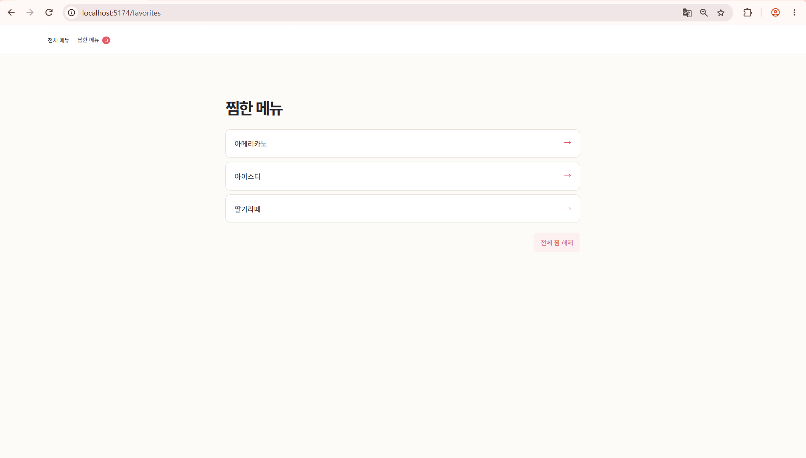
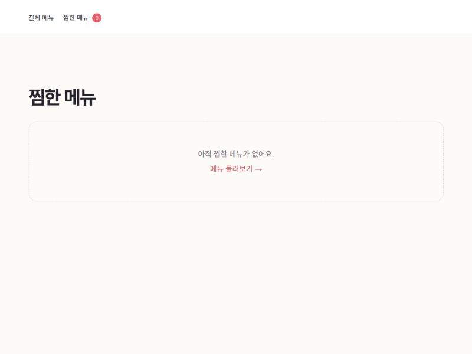

# Week3 - 전체 찜 해제 버튼

React Router와 Zustand로 만든 음료 메뉴 앱에 **전체 찜 해제** 버튼을 추가한 과제입니다.

찜한 메뉴가 있을 때 찜 목록 아래에 버튼이 보이고, 누르면 모든 찜이 한 번에 해제됩니다.

## 실행

```bash
cd Week3
npm ci
npm run dev
```

## 구현 내용

- `useFavoriteStore`에 `clearFavorites` action 추가

```js
clearFavorites: () => set({ favoriteIds: [] }),
```

- `FavoritesPage`에서 `clearFavorites`를 가져와 **전체 찜 해제** 버튼에 연결
- 찜한 메뉴가 없으면 버튼 대신 "아직 찜한 메뉴가 없어요." 안내가 보임

## 동작 화면

### 찜 해제 버튼

아메리카노, 아이스티, 딸기라떼를 찜한 뒤 찜 목록 아래에 버튼이 생긴 화면입니다.



### 찜 해제 성공

버튼을 누른 뒤 찜 목록이 비고, 상단의 찜 개수도 0이 된 화면입니다.


