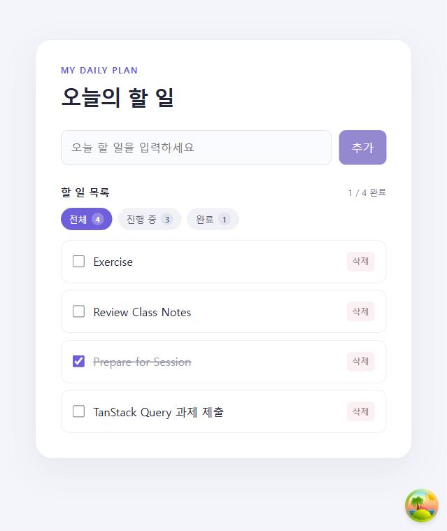
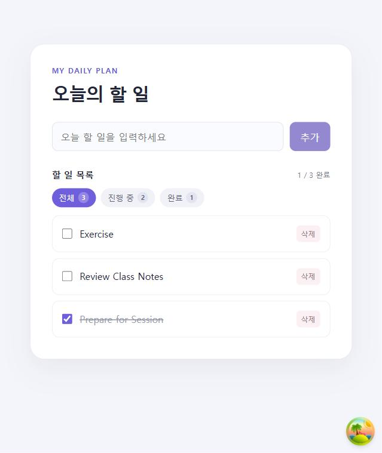
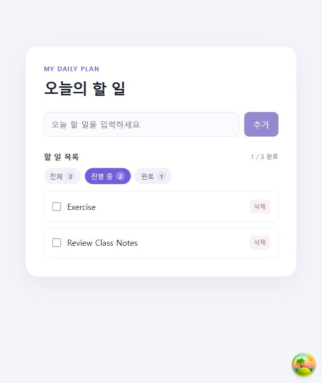
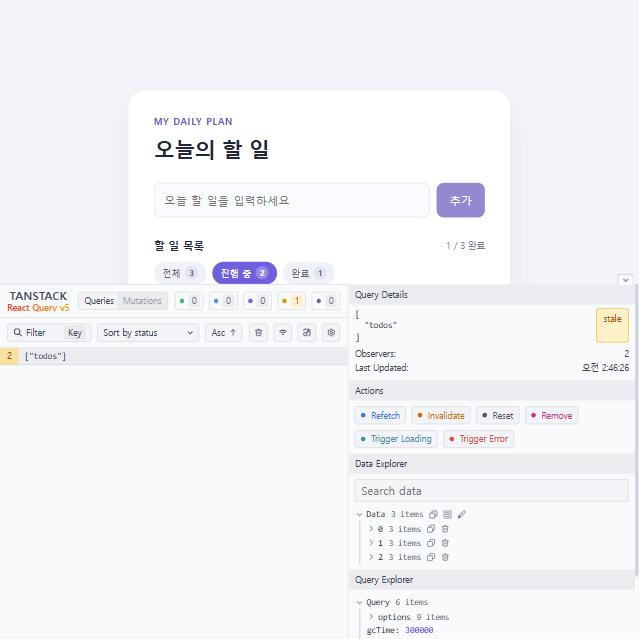

# TanStack Query + API 연동 기초 과제

세션에서 만든 Todo List(조회 · 추가 · 완료 체크)에 아래 두 가지를 더했습니다.

1. **Todo 삭제** — `useMutation` + `setQueryData`로 목록을 다시 조회하지 않고 삭제 반영
2. **`select` 옵션** — 하나의 캐시를 그대로 두고 화면에 맞게 데이터를 골라 쓰는 필터 탭(전체 / 진행 중 / 완료)

## 실행

터미널 두 개가 필요합니다.

```bash
npm ci
npx json-server server/db.json   # 터미널 1: 가짜 API 서버 (localhost:3000)
npm run dev                      # 터미널 2: React 화면
```

## 폴더 구조

```
server/db.json            가짜 DB (json-server)
src/
├── api/todo.ts           HTTP 요청만 담당 (fetchTodos, createTodo, updateTodo, deleteTodo)
├── hooks/useTodosData.ts useQuery 설정 (useTodosData, useTodoCount)
├── components/
│   ├── TodoForm.tsx      추가 (useMutation + setQueryData)
│   └── TodoList.tsx      완료 체크(낙관적 업데이트) · 삭제
└── App.tsx               화면 구성, 필터 탭
```

---

## 과제 1. Todo 삭제

### 코드

**API 함수** — `src/api/todo.ts`

```ts
export const deleteTodo = async (id: string): Promise<string> => {
  const response = await fetch(`http://localhost:3000/todos/${id}`, {
    method: "DELETE",
  });

  if (!response.ok) {
    throw new Error("할 일을 삭제하지 못했습니다.");
  }

  return id;
};
```

json-server의 DELETE 응답에는 쓸 만한 값이 없어서, 삭제한 `id`를 대신 돌려줍니다. 이 값이 `onSuccess`의 인자로 넘어갑니다.

**삭제 Mutation** — `src/components/TodoList.tsx`

```ts
const { mutate: deleteTodoMutate, isPending: isDeletePending } = useMutation({
  mutationFn: deleteTodo,

  onSuccess: async (deletedId) => {
    // 진행 중인 조회 결과가 삭제 전 목록을 덮어쓰지 않도록 취소
    await queryClient.cancelQueries({ queryKey: ["todos"] });

    queryClient.setQueryData<Todo[]>(["todos"], (prevTodos) => {
      return prevTodos?.filter((todo) => todo.id !== deletedId);
    });
  },
});
```

- `invalidateQueries`를 쓰면 삭제 후 `GET /todos`로 목록 전체를 다시 받아옵니다.
- 대신 `setQueryData`로 캐시에서 해당 id만 빼서, **추가 요청 없이** 화면을 바꿉니다.
- 완료 체크(낙관적 업데이트)와 삭제가 겹치지 않도록, 둘 중 하나가 처리 중이면 체크박스와 삭제 버튼을 모두 막았습니다 (`isBusy`).

### 확인

| 삭제 전 | 삭제 후 |
|---|---|
|  |  |

- [x] 삭제 버튼을 누르면 해당 Todo가 화면에서 사라진다
- [x] `server/db.json`에서도 해당 Todo가 삭제된다
- [x] 새로고침해도 삭제한 Todo가 다시 나타나지 않는다
- [x] Network 탭에서 `DELETE /todos/{id} → 200` 요청을 확인했다
- [x] 삭제 성공 후 `GET /todos` 요청 없이 캐시가 갱신된다

---

## 과제 2. `select` 옵션

### 어떤 기능인가

`useQuery`의 `select`는 **캐시에 저장된 데이터는 그대로 두고, 컴포넌트가 받을 값만 바꿔 주는** 옵션입니다.

- 캐시(`["todos"]`)에는 항상 서버에서 받은 전체 목록이 들어 있습니다.
- 각 컴포넌트는 `select`로 필요한 모양(필터된 목록, 개수 등)만 받아 갑니다.
- 같은 쿼리 키를 쓰므로 **요청은 한 번만** 나가고, 탭을 바꿔도 서버에 다시 요청하지 않습니다.
- `select` 결과가 이전과 같으면 컴포넌트가 다시 렌더링되지 않습니다.

이걸로 **전체 / 진행 중 / 완료** 필터 탭과 탭별 개수를 만들었습니다.

### 코드

`src/hooks/useTodosData.ts`

```ts
// select에 넘길 함수는 컴포넌트 밖에 둔다.
// 참조가 매번 바뀌지 않아야 select를 불필요하게 다시 실행하지 않는다.
const selectByFilter: Record<TodoFilter, (todos: Todo[]) => Todo[]> = {
  all: (todos) => todos,
  active: (todos) => todos.filter((todo) => !todo.completed),
  done: (todos) => todos.filter((todo) => todo.completed),
};

const selectCount = (todos: Todo[]) => {
  const done = todos.filter((todo) => todo.completed).length;
  return { all: todos.length, active: todos.length - done, done };
};

export const useTodosData = (filter: TodoFilter = "all") =>
  useQuery({
    queryKey: ["todos"],
    queryFn: fetchTodos,
    staleTime: 30000,
    select: selectByFilter[filter], // 필터에 맞는 항목만
  });

export const useTodoCount = () =>
  useQuery({
    queryKey: ["todos"],
    queryFn: fetchTodos,
    staleTime: 30000,
    select: selectCount, // 같은 캐시에서 개수만
  });
```

`src/App.tsx`에서는 탭 상태(`filter`)만 들고 있다가 `useTodosData(filter)`에 넘깁니다. 필터링을 위해 따로 state나 `useMemo`를 만들 필요가 없습니다.

**과제 1과 함께 쓸 때:** 추가·삭제·완료 체크는 모두 `setQueryData`로 **캐시 원본(전체 목록)**을 고칩니다. `select`는 그 원본에서 다시 골라내기만 하므로, 예를 들어 "진행 중" 탭에서 체크하면 그 항목이 바로 목록에서 빠지고 탭 숫자도 함께 바뀝니다.

### 확인

| 진행 중 탭 | DevTools |
|---|---|
|  |  |

- 화면에는 진행 중 2개만 보이지만, DevTools의 `["todos"]` 캐시에는 **전체 3개**가 그대로 있습니다.
- **Observers: 2** — 목록(`useTodosData`)과 개수(`useTodoCount`) 두 곳이 같은 캐시 하나를 함께 씁니다.
- 탭을 여러 번 바꿔도 `localhost:3000`으로 가는 요청은 **0개**였습니다.

---

## 세션 실습 내용

- **조회:** `useQuery` + 커스텀 훅 분리 (`api` / `hooks` / `components`)
- **캐시:** `staleTime`(Fresh → Stale), `gcTime`, React Query DevTools로 상태 확인. `staleTime: 30000`으로 두고 탭 복귀 시 Fresh면 요청 0개, Stale이면 재조회 1개 확인
- **추가:** `useMutation` → `invalidateQueries` 방식에서 `setQueryData`(응답값 이용) 방식으로 변경
- **완료 체크:** 낙관적 업데이트 — `onMutate`에서 백업 후 캐시 먼저 수정, `onError`에서 롤백, `onSettled`에서 서버와 다시 맞춤. 5초 지연 + `invalid-todos` 주소로 실패시켜 체크가 원래대로 돌아오는 것(Rollback) 확인 후 원래 코드로 되돌림
